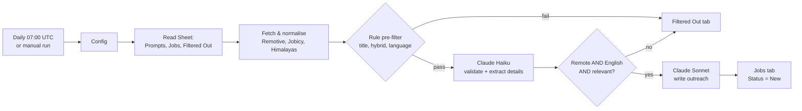

# RAY | Executive Assistant Job Outreach Automation

An n8n workflow that runs every morning, finds companies hiring remote Executive and Administrative Assistants, checks each posting is remote, English-speaking and genuinely relevant, writes a personalised outreach email with Claude and drops everything into a Google Sheet the sales team works from.

- **Sources:** Remotive, Jobicy and Himalayas public JSON APIs. No LinkedIn, no HTML scraping, no logins.
- **Validation:** cheap rules first, then Claude makes the final call with strict JSON output.
- **Outreach:** prompt lives in the Google Sheet, so tone can be changed or A/B tested without touching n8n.
- **Dashboard:** one Google Sheet with a Jobs tab for the rep, a Filtered Out tab that explains every rejection and a Prompts tab.

---

## How it works



| Step | What happens | Why |
|---|---|---|
| 1. Config | One Code node holds the Sheet ID, search terms, sources, filters, models and limits | Single place to change behaviour |
| 2. Dedupe | Every URL already in the Jobs or Filtered Out tab is skipped. Cross-posted jobs (same company and title on two boards) are merged. Postings older than 21 days are ignored | Nothing is checked, paid for or messaged twice |
| 3. Fetch | Each board is called with each search term. One board failing does not stop the others | Resilience |
| 4. Rule pre-filter | Title must match an EA/Admin pattern and not an excluded one. Titles saying hybrid or on-site are dropped. Descriptions not written in English, or that require another language, are dropped | Removes obvious mismatches for free before any LLM cost |
| 5. Claude validation | Haiku returns a forced tool call: `is_remote`, `is_english_speaking`, `is_relevant`, evidence for each, plus who the EA supports, top 3 responsibilities and tools named | Final judgement plus the raw material for personalisation |
| 6. Claude outreach | Sonnet writes the email using the active prompt from the Prompts tab, filled with the details above | Messages reference real specifics from each posting |
| 7. Save | Qualified jobs are appended to Jobs. Every rejection is appended to Filtered Out with the stage and reason | The rep has a clean queue and the filter is auditable |

If a Claude call fails (rate limit, timeout), that posting is **not** logged anywhere, so it is automatically retried on the next run.

---

## Repository layout

```
workflow/ea-outreach.n8n.json      Import this into n8n
src/nodes/*.js                     Source of every Code node (readable, diffable, testable)
scripts/build-workflow.mjs         Rebuilds the workflow JSON from src/nodes
scripts/build-sheet-template.py    Rebuilds the Google Sheet template
sheet-template/EA-Outreach-Dashboard.xlsx   Upload to Google Drive to create the dashboard
test/run-tests.mjs                 Offline tests with mocked APIs, Sheets and Claude
sample-output/                     CSV export from a live run
```

---

## Install (about 15 minutes)

**Requirements:** an n8n instance (self-hosted or cloud, v1.x or later), a Google account and an Anthropic API key.

### 1. Create the Google Sheet
1. Upload `sheet-template/EA-Outreach-Dashboard.xlsx` to Google Drive.
2. Open it, then **File > Save as Google Sheets**. Work in the new Google Sheets copy.
3. Copy the Sheet ID from the URL: `https://docs.google.com/spreadsheets/d/`**`THIS_PART`**`/edit`
4. Keep the tab names exactly as they are: `Jobs`, `Filtered Out`, `Prompts`, `How To Use`.

### 2. Import the workflow
In n8n: **Workflows > Import from File** and choose `workflow/ea-outreach.n8n.json`.

### 3. Add credentials
| Credential | Type in n8n | Settings |
|---|---|---|
| Google Sheets account | Google Sheets OAuth2 API | Sign in with the Google account that owns the Sheet |
| Anthropic API Key | Header Auth | Name: `x-api-key` Value: your Anthropic key |

Open these nodes and pick the credential: `Read Prompt Library`, `Read Saved Jobs`, `Read Filtered Out`, `Save to Jobs Tab`, `Log to Filtered Out Tab` (Google Sheets) and `Claude: Validate Job`, `Claude: Write Outreach` (Header Auth).

### 4. Set the Sheet ID
Open the **Config** node and replace `PASTE_YOUR_GOOGLE_SHEET_ID_HERE`. Update `sender.name` and `sender.pitch` if needed.

### 5. Test, then switch on the schedule
1. Click **Execute workflow** (uses the Run Manually trigger). First run takes 1 to 3 minutes.
2. Check the Jobs and Filtered Out tabs.
3. Activate (publish) the workflow. It now runs daily at 07:00 UTC.

---

## How to run

| Want to | Do this |
|---|---|
| Run now | Open the workflow and click **Execute workflow** |
| Change the time | Open **Daily Schedule** and edit the cron expression (`0 7 * * *` = 07:00 every day; `0 7 * * 1` = Mondays only). Timezone is under workflow **Settings** |
| See what a run did | **Executions** tab. The `_runStats` field on any item from **Fetch & Normalize Jobs** shows fetched, already in sheet, too old, duplicates and any board errors |
| Pause it | Deactivate the workflow |

Polling once a day stays well inside every board's limits (Remotive asks for at most 4 calls a day, Jobicy at most one poll an hour).

---

## Adjusting filters

Everything is in the **Config** node:

| Setting | Effect |
|---|---|
| `searchTerms` | Keywords sent to every board. Add `"personal assistant"` or `"executive business partner"` to widen the net |
| `sources` | Set any board to `false` to stop using it |
| `maxAgeDays` | Ignore postings older than this |
| `maxNewJobsPerRun` | Max postings sent to Claude per run (cost cap). Extra postings are picked up next run |
| `filters.titleInclude` / `titleExclude` | Regex patterns for the title relevance check |
| `filters.titleNonRemote` | Title words that mean the job is not remote |
| `filters.rejectIfOtherLanguageRequired` | `true` drops jobs that require e.g. Spanish. A language listed as "a plus" is still allowed |
| `llm.validationModel` / `outreachModel` | Claude models used for each step |

To see the effect of a change, check the **Filtered Out** tab: each row says whether it was rejected by the Rules or by LLM validation and why.

---

## Changing the outreach prompt (no n8n needed)

Prompts live in the **Prompts** tab of the Sheet:

| Version | Active | System Prompt | User Prompt | Notes |
|---|---|---|---|---|
| v1-consultative | TRUE | ... | ... | Default |
| v2-direct | FALSE | ... | ... | Shorter variant |

- **Switch style:** set the row you want to `TRUE` and the others to `FALSE`.
- **A/B test:** set two or more rows to `TRUE`. Each posting randomly gets one, and the `Prompt Version` column records which, so reply rates can be compared by filtering on Status.
- **Write a new one:** add a row. These placeholders are filled automatically:

`{{job_title}}` `{{company_name}}` `{{location}}` `{{job_description}}` `{{executive_supported}}` `{{key_responsibilities}}` `{{tools_mentioned}}` `{{language_requirements}}` `{{source}}` `{{sender_name}}` `{{sender_company}}` `{{sender_pitch}}`

If no row is Active, the workflow falls back to the default prompt in the Config node, so it never breaks.

---

## How the sales rep uses the Sheet

The **Jobs** tab is the work queue. Columns:

| Column | Meaning |
|---|---|
| Job Posting URL, Job Title, Company Name, Location, Job Description | The posting |
| LLM-Generated Outreach Message | Ready-to-send draft. First line is the subject |
| Status | New, Contacted, Replied, Meeting Booked, Not Interested or Skip (rows are colour coded) |
| Owner, Rep Notes | For the rep |
| Date Posted, Date Added, Source | Freshness and where it came from |
| Language Requirements, Validation Notes | Why Claude accepted it |
| Prompt Version | Which prompt wrote the message |

Daily routine:
1. Filter Status = **New**.
2. Open the posting, find the hiring contact (company site, careers page or the posting itself), personalise the draft if needed and send it.
3. Set Owner and Status = **Contacted**. Move Status along as the conversation progresses.
4. Do not delete rows. The URL column is how the automation knows a posting was already handled. Filter or hide instead.

The same instructions are in the **How To Use** tab.

---

## Troubleshooting

| Symptom | Cause and fix |
|---|---|
| `Sheet with name Jobs not found` | Tabs were renamed or the xlsx was not converted. Use **File > Save as Google Sheets** and keep tab names exactly |
| `The caller does not have permission` | The Google credential's account cannot edit the Sheet. Share the Sheet with it or reconnect |
| Claude nodes return `401` | Header Auth name must be `x-api-key` and the value a valid Anthropic key |
| Claude nodes return `429` or `529` | Rate limit or overload. The nodes retry 3 times; anything still failing is retried on the next run. Lower `maxNewJobsPerRun` or the batch size in the Claude node options |
| `model not found` | Change `llm.validationModel` / `outreachModel` in Config to a model your key can use |
| Run finishes but Jobs is empty | Normal on quiet days. Check `_runStats` on Fetch & Normalize Jobs and the Filtered Out tab. If everything says "already in sheet", there is simply nothing new |
| One board shows an error in `_runStats.errors` | That board was down or changed. The others still ran. If it persists, set it to `false` in `sources` |
| Too many good jobs rejected | Read the reasons in Filtered Out. Loosen `titleInclude`, or set `rejectIfOtherLanguageRequired` to `false` |
| Execution "succeeded" but nothing happened after Fetch | No new postings, so the workflow stops early. This is expected |

---

## Compliance

- Only official public APIs are used; LinkedIn is not touched.
- Every row keeps the canonical posting URL and the Source column, as Remotive, Jobicy and Himalayas ask for attribution.
- Listings are used internally for outreach, not republished as a job board.
- Polling is once a day.

---

## Development

```bash
node test/run-tests.mjs                 # offline tests: dedupe, filters, prompts, error retry
node scripts/build-workflow.mjs         # rebuild workflow JSON after editing src/nodes
python3 scripts/build-sheet-template.py # rebuild the Sheet template
```

The tests execute every Code node exactly as n8n does, against fixtures shaped like each board's documented response, and cover: skipping URLs already in the Sheet, dropping old and cross-posted jobs, rejecting non-EA titles, hybrid titles, non-English descriptions and jobs requiring another language, the Sheet prompt being used and filled, the fallback prompt and a failed Claude call being retried instead of logged.

## Cost

Per qualified posting: one Haiku call (about 2k tokens) plus one Sonnet call (about 2.5k tokens). At 40 qualified postings a day this stays well under one US dollar a day.
